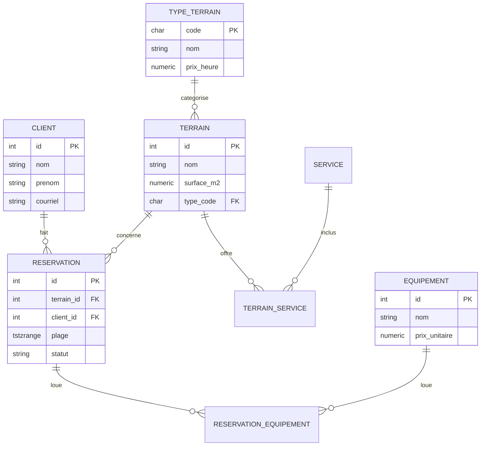

# Terrain Foot — Réservation de terrains de foot intérieur

API de réservation pour un centre sportif : gestion des clients, des terrains,
des réservations (avec prévention des doubles réservations directement au
niveau de la base de données) et de la location d'équipement.

Stack : **PostgreSQL** · **FastAPI** · **Docker** · tests **pytest** · **CI GitHub Actions**

## Point fort technique

Deux réservations ne peuvent jamais se chevaucher sur le même terrain — pas
seulement vérifié côté code, mais **garanti par PostgreSQL lui-même** via une
contrainte d'exclusion (`EXCLUDE USING gist`) sur une plage horaire
(`tstzrange`). Même en cas de requêtes concurrentes, la base refuse l'insertion
en conflit (erreur `ExclusionViolation`), que l'API traduit en `409 Conflict`.

```sql
EXCLUDE USING gist (terrain_id WITH =, plage WITH &&)
    WHERE (statut = 'confirmee')
```

C'est vérifié par un test de concurrence : 8 requêtes lancées en même temps
sur le même créneau, une seule réussit et les 7 autres reçoivent un conflit.
Ce test a révélé un piège : des insertions simultanées en conflit s'attendent
mutuellement, et PostgreSQL en interrompt une avec `deadlock detected` (une
erreur 500 côté API) plutôt qu'avec une violation de contrainte. Un verrou de
ligne sur le terrain (`SELECT ... FOR NO KEY UPDATE`) met ces requêtes en file,
et chacune obtient alors un `409` propre.

## Règles métier

- **Pas de double réservation** d'un terrain sur un même créneau (contrainte
  d'exclusion ci-dessus) ; une réservation annulée libère son créneau.
- **Capacité** : `nb_joueurs` ne peut pas dépasser la `capacite_max` du terrain.
- **Stock d'équipement compté par créneau** : le stock est le nombre d'unités
  louables en même temps. Deux réservations simultanées sur des terrains
  différents se partagent le même stock ; une réservation à un autre moment,
  ou annulée, ne le consomme pas.
- **Courriel unique** par client.
- Une réservation refusée n'est jamais créée à moitié (tout est dans une seule
  transaction).

## Modèle de données



## Lancer le projet

### Avec Docker (recommandé)

```bash
docker compose up --build
```

L'API est ensuite disponible sur <http://localhost:8000> (documentation
interactive sur `/docs`). La base est initialisée automatiquement avec le
schéma et des données de démonstration.

### En local, sans Docker

Nécessite PostgreSQL 16+ avec l'extension `btree_gist`.

```bash
python3 -m venv .venv
source .venv/bin/activate
pip install -r requirements.txt

createdb terrain_foot
psql -d terrain_foot -f db/schema.sql
psql -d terrain_foot -f db/seed.sql

cp .env.example .env   # ajuster si besoin
uvicorn app.main:app --reload
```

## Démo en console

`demo_cli.py` est un petit client interactif (bibliothèque standard
uniquement) qui pilote l'API depuis un menu texte :

```bash
python3 demo_cli.py
```

```text
=== Terrain Foot ===
1. Lister les terrains
2. Créer un client
3. Voir l'occupation des terrains
4. Faire une réservation
5. Lister les réservations
6. Annuler une réservation
0. Quitter
Votre choix : 4

  ID du terrain : 1
  ID du client : 1
  Début (AAAA-MM-JJ HH:MM) : 2026-12-01 18:00
  Fin (AAAA-MM-JJ HH:MM) : 2026-12-01 19:00
  Nombre de joueurs : 8
  ✓ Réservation 1 confirmée : terrain 1, 2026-12-01 18:00 -> 2026-12-01 19:00, total 60.00 $

Votre choix : 4
  (mêmes valeurs)
  ✗ RÉSERVATION REFUSÉE : chevauchement avec une réservation existante.
    (Ce terrain est deja reserve sur ce creneau)
```

## Lancer les tests

Avec Docker (aucune installation locale) :

```bash
docker compose up -d db
docker compose exec db createdb -U postgres terrain_foot_test
docker compose run --rm -v "$PWD":/src -w /src -e DB_NAME=terrain_foot_test api pytest -v
```

Ou en local :

```bash
createdb terrain_foot_test
psql -d terrain_foot_test -c "CREATE EXTENSION IF NOT EXISTS btree_gist;"
pytest -v
```

La suite (25 tests) couvre : création de réservation, rejet d'un
chevauchement, acceptation de créneaux adjacents, libération d'un créneau
après annulation, calcul du prix total avec équipement, capacité du terrain,
stock d'équipement par créneau, courriel en double, réservations concurrentes
(créneau et stock), et les erreurs attendues (dates invalides, terrain, client
ou équipement inexistant).

Une CI GitHub Actions (`.github/workflows/ci.yml`) relance cette suite à
chaque push, avec un vrai service PostgreSQL.

## Points d'API

| Méthode | Route                  | Description                              |
| ------- | ----------------------- | ----------------------------------------- |
| GET     | `/health`               | Vérification de l'état du service         |
| POST    | `/clients`               | Crée un client (409 si courriel déjà utilisé) |
| GET     | `/clients`               | Liste les clients                         |
| GET     | `/terrains`              | Liste les terrains et leurs services      |
| GET     | `/terrains/occupation`   | Heures réservées par terrain              |
| POST    | `/reservations`          | Crée une réservation (409 si chevauchement ou stock insuffisant, 422 si capacité dépassée) |
| GET     | `/reservations`          | Liste les réservations                    |
| GET     | `/reservations/{id}`     | Détail d'une réservation (avec total)     |
| DELETE  | `/reservations/{id}`     | Annule une réservation                    |

Exemple :

```bash
curl -X POST http://localhost:8000/reservations \
  -H "Content-Type: application/json" \
  -d '{
    "terrain_id": 1,
    "client_id": 1,
    "debut": "2026-12-01T18:00:00Z",
    "fin": "2026-12-01T19:00:00Z",
    "nb_joueurs": 8,
    "equipements": [{"equipement_id": 1, "quantite": 2}]
  }'
```

## Structure

```
app/              Code de l'API (FastAPI, accès BD, logique métier)
db/schema.sql     Schéma PostgreSQL (tables, contraintes, vue, fonction)
db/seed.sql       Données de démonstration
tests/            Suite pytest
demo_cli.py       Client interactif en console
.github/workflows/ci.yml   Intégration continue
docker-compose.yml, Dockerfile   Conteneurisation
```

## Auteur

Abdoul Wadoud Bello
